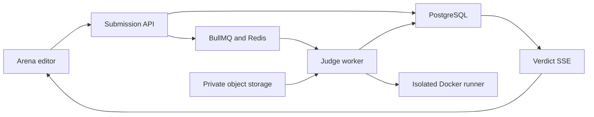

# Place AI

**Learn → Build → Get placed → Earn**

Place AI is a CSE-first student career platform. Its Skill Passport brings together practice outcomes, projects and source links a recruiter can inspect. The Coding Arena adds an asynchronous C++ and Python judge with a live contest leaderboard.

## Run locally

Requires Docker Desktop or Docker Engine with the Compose plugin. The first run pulls base images and installs dependencies.

```sh
docker compose up --build
```

Open [Place AI](http://127.0.0.1:4173) or go straight to the [Coding Arena](http://127.0.0.1:4173/arena). The seed service provisions 14 practice problems, 30 Python Decode challenges, and a seven-day starter contest on its first run.

To try the judge, open **Array Sum**, choose Python 3 and submit the following:

```python
import sys

values = list(map(int, sys.stdin.read().split()))
print(sum(values[1:]))
```

Use **Run** for custom input and **Submit** to grade against the test bank. The editor stays in a screen-fit workspace with keyboard-operable splitters, internal scrolling and separate Description, Hints, Editorial and Submissions views in standard practice.

```sh
docker compose exec web npm run db:seed
docker compose down
```

The seed command can be rerun. It also upgrades older Arena databases to include topic labels and example explanations. Compose volumes retain the database, queue and object fixtures when stopping the stack.

Open [Decode](http://127.0.0.1:4173/arena/decode) to see all 30 buggy programs by default. Open a challenge, run the prefilled example, compare actual and expected output, edit the starter, then submit against the judge. An accepted fix unlocks the editorial and updates the difficulty breakdown and accepted challenge list on the Skill Passport. The Evidence Engine shows the same accepted repairs.

## What works

| Area | Current behavior |
| --- | --- |
| Roadmap | Rule-based branch, college year and target-role guidance. CSE is the default. Starter theory tracks cover ECE, EEE, Mechanical and Civil. |
| Mini challenges | Technical MCQs, coding output, debugging and practical questions. Correct responses create browser-local evidence. |
| Placements | Browser-local interview and résumé preparation checklist. |
| Marketplace | Category and branch filters, bookmarks and local listing drafts. |
| Skill Passport | Editable career-card draft, practice outcomes, source URLs and a shareable fictional sample card with QR. |
| Coding Arena | Interactive Three.js pipeline, Monaco editor, C++20 and Python 3, custom runs, live SSE verdicts and submission history. |
| Decode | 10 Easy, 10 Medium and 10 Hard Python bug fixes. Custom runs, per-challenge browser drafts, hidden tests, editorial unlock and distinct accepted credit. |
| Contests | Seeded contest, scoring from accepted submissions and a refreshing leaderboard with animated rank changes. |

Roadmaps currently use rules. Real student account sharing, evidence review, marketplace payments and internship listings are future work. The judge uses a signed browser session for local submission ownership.

## How a submission moves through the system



1. The API validates the language, code size and session quota. PostgreSQL commits the submission with status `PENDING`, then the API schedules its ID.
2. BullMQ retries transient errors. The worker also requeues unfinished rows that have lost their Redis job and closes out jobs that exhausted retries.
3. Compilation runs in its own container. Each case starts a fresh, non-root container with no network, a read-only root filesystem and bounded CPU, memory, processes and output.
4. The worker fetches cases from S3-compatible storage. It checks output, stores the verdict and updates contest scoring under a row lock. The browser receives live changes over SSE.
5. Contest points equal the number of accepted problems. Penalty is the time to first acceptance plus 20 minutes for each earlier WA, TLE, MLE or RE on that problem. Custom runs carry no contest score.

The default 2s time limit applies to the program inside its container. The elapsed time displayed in the UI includes container startup. The seeded repository contains example fixtures. For a real contest, inject private tests through object storage and keep them out of source control.

## Repository map

| Path | Purpose |
| --- | --- |
| `assets/` | Student site, sample data, styling and local QR rendering |
| `arena/` | React arena, Monaco integration, Three.js scene and responsive workspace |
| `judge/api.mjs` | Session ownership, JSON endpoints and verdict events |
| `judge/worker.mjs` | BullMQ execution, reconciliation and contest scoring |
| `judge/container.mjs` | Container lifecycle, limits and compiler launch |
| `judge/verdict.ts` | Typed verdict checking and output normalization |
| `db/schema.sql` | PostgreSQL tables, constraints and leaderboard index |
| `scripts/smoke.mjs` | End-to-end submission, isolation and leaderboard checks |

## Development and verification

```sh
npm install
npm run check
npm test
npm run build:arena
node scripts/smoke.mjs
```

The judge uses a skeleton while fetching content, a queue bar with unknown duration, a compile spinner, and case progress from the worker. CSS animations respect reduced motion.

Standard practice problems have three **Hints** steps. Easy walks through the goal and a small example. Medium starts from a direct approach and reveals an optimization. Hard connects the model and invariant to the constraints. Practice mode exposes the guide alongside the full editorial.

Decode focuses on repairing supplied implementations. The default lists and direct question links work without choosing a topic. The web server provides public statements, samples and starter source when the judge services are unavailable. Execution and verified progress require the judge.

The smoke test requires a freshly seeded Compose stack because it expects one clean contest leaderboard and only the test session’s submissions. It covers successful and incorrect submissions, compilation failure, timeout, C++ custom output, SSE, session isolation and contest scoring. GitHub Actions runs these checks and builds the Compose stack on pushes to `main` and pull requests.

Run `npm run build:arena` followed by `npm run dev` to browse questions without infrastructure. Use Compose for code execution and verified progress. The fixture tests require Python 3 on the development machine or CI runner. Use `docker compose logs worker` for judging errors.

See [the launch audit](LAUNCH-AUDIT.md) for review findings, fixes and remaining launch gates.

## Deployment boundary

The Compose profile is a local development environment bound to loopback. The worker uses your Docker daemon to launch runners and must be treated as a privileged service. A public judge should use a separate execution host with a managed sandbox boundary, durable identity, rate limiting and private test storage. Replace all local defaults before deployment. Publishing this source on GitHub does not deploy the app.

## Profile settings

Open **My profile → Edit profile** to manage identity, personal details, education and work, career preferences, and showcase visibility. Each section saves independently in this browser. Photos are resized to a square JPEG before saving. Résumé PDFs stay in browser storage and can be downloaded or removed in Career preferences. Contact details, date of birth, postal code and résumé are excluded from the showcase. The profile editor uses the current browser profile, without shared accounts or cross-device synchronization.

## Evidence Engine

The **Skill Passport** displays judge-recorded Arena statistics and a 12-week activity grid. Students can attach project and assessment sources. Synexis is a fictional sample built from the supplied Python, SQL, GitHub and Java practice examples.

| Source | Access | Imported evidence |
| --- | --- | --- |
| Place AI Arena | Signed Arena session | Unique accepted problems, accepted Python problems, acceptance rate, submission dates |
| GitHub | GitHub OAuth app, public read scope | Owned public repositories and commit and PR contributions for the past year |
| Codeforces | Official public API | Current and peak rating, distinct accepted problems and topic breakdown from up to 250 recent submissions |
| LinkedIn | Sign in with LinkedIn using OpenID Connect | Member name from UserInfo |
| LeetCode, HackerRank, CodeChef | Student-provided links | Source links shown separately from API-backed activity |

### Configure OAuth

1. Set `EVIDENCE_PUBLIC_ORIGIN` to the exact origin used to open Place AI. The local default is `http://127.0.0.1:4173`. Use HTTPS for a hosted deployment.
2. Register a GitHub OAuth app with the callback `{origin}/api/evidence/github/callback`.
3. Register a LinkedIn application, request **Sign in with LinkedIn using OpenID Connect**, and register `{origin}/api/evidence/linkedin/callback` in its authorized redirect URLs.
4. Save the following values in the repository’s ignored `.env` for Docker Compose. Generate a distinct signing secret with `openssl rand -hex 32`.

```dotenv
EVIDENCE_PUBLIC_ORIGIN=http://127.0.0.1:4173
EVIDENCE_SESSION_SECRET=
GITHUB_CLIENT_ID=
GITHUB_CLIENT_SECRET=
LINKEDIN_CLIENT_ID=
LINKEDIN_CLIENT_SECRET=
```

Restart the web container with `docker compose up -d web`, then open **My profile → Connected platforms**. OAuth access tokens stay on the server during the import. The browser retains signed snapshots for 30 days. Removing a snapshot clears it from Place AI. Provider-side app authorization can be managed in each platform’s own account settings.

Official references are available for [GitHub OAuth](https://docs.github.com/en/apps/oauth-apps/building-oauth-apps/authorizing-oauth-apps), [GitHub GraphQL contributions](https://docs.github.com/en/graphql/reference/users), [Codeforces API](https://codeforces.com/apiHelp), [LinkedIn OpenID Connect](https://learn.microsoft.com/en-us/linkedin/consumer/integrations/self-serve/sign-in-with-linkedin-v2), [HackerRank for Work APIs](https://support.hackerrank.com/articles/2067417637) and [LeetCode’s terms](https://leetcode.com/terms/).
