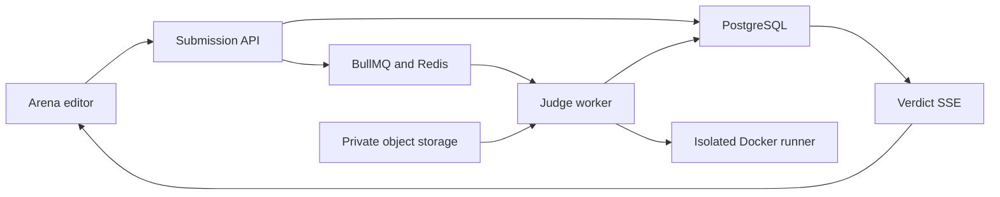

# Place AI

**Learn → Build → Get placed → Earn**

Place AI is a CSE-first student career platform. Its Skill Passport brings together practice outcomes, projects and source links a recruiter can inspect. The Coding Arena adds an asynchronous C++ and Python judge with a live contest leaderboard.

## Run locally

Requires Docker Desktop or Docker Engine with the Compose plugin. The first run pulls base images and installs dependencies.

```sh
docker compose up --build
```

Open [Place AI](http://127.0.0.1:4173) or go straight to the [Coding Arena](http://127.0.0.1:4173/arena). The seed service provisions six problems, a sample per problem and a seven-day starter contest on its first run.

To try the judge, open **Array Sum**, choose Python 3 and submit the following:

```python
import sys

values = list(map(int, sys.stdin.read().split()))
print(sum(values[1:]))
```

Use **Run** for custom input and **Submit** to grade against the test bank. The editor stays in a screen-fit workspace with keyboard-operable splitters, internal scrolling and separate Description, Editorial and Submissions views.

```sh
docker compose exec web npm run db:seed
docker compose down
```

The seed command can be rerun. Compose volumes retain the database, queue and object fixtures when stopping the stack.

## What works

| Area | Current behavior |
| --- | --- |
| Roadmap | Rule-based branch, college year and target-role guidance. CSE is the default. Starter theory tracks cover ECE, EEE, Mechanical and Civil. |
| Mini challenges | Technical MCQs, coding output, debugging and practical questions. Correct responses create browser-local evidence. |
| Placements | Browser-local interview and résumé preparation checklist. |
| Marketplace | Category and branch filters, bookmarks and local listing drafts. |
| Skill Passport | Editable career-card draft, practice outcomes, source URLs and a shareable fictional sample card with QR. |
| Coding Arena | Interactive Three.js pipeline, Monaco editor, C++20 and Python 3, custom runs, live SSE verdicts and submission history. |
| Contests | Seeded contest, scoring from accepted submissions and a refreshing leaderboard with animated rank changes. |

Roadmaps currently use rules. Real student account sharing, evidence review, live career-platform imports, marketplace payments and internship listings are future work. The judge uses a signed browser session for local submission ownership.

## How a submission moves through the system



1. The API validates the language, code size and session quota. PostgreSQL commits the submission with status `PENDING`, then the API schedules its ID.
2. BullMQ retries transient errors. The worker also requeues unfinished rows that have lost their Redis job and closes out jobs that exhausted retries.
3. Compilation runs in its own container. Each case starts a fresh, non-root container with no network, a read-only root filesystem and bounded CPU, memory, processes and output.
4. The worker fetches cases from S3-compatible storage. It checks output, stores the verdict and updates contest scoring under a row lock. The browser receives live changes over SSE.
5. Contest points equal the number of accepted problems. Penalty is the time to first acceptance plus 20 minutes for each earlier WA, TLE, MLE or RE on that problem. Custom runs carry no contest score.

The default 2s time limit applies to the program inside its container. The elapsed time displayed in the UI includes container startup. The seeded repository contains example fixtures. For a real contest, inject private tests through object storage and keep them out of source control.

## Repository map

| Path | Purpose |
| --- | --- |
| `assets/` | Student site, sample data, styling and local QR rendering |
| `arena/` | React arena, Monaco integration, Three.js scene and responsive workspace |
| `judge/api.mjs` | Session ownership, JSON endpoints and verdict events |
| `judge/worker.mjs` | BullMQ execution, reconciliation and contest scoring |
| `judge/container.mjs` | Container lifecycle, limits and compiler launch |
| `judge/verdict.ts` | Typed verdict checking and output normalization |
| `db/schema.sql` | PostgreSQL tables, constraints and leaderboard index |
| `scripts/smoke.mjs` | End-to-end submission, isolation and leaderboard checks |

## Development and verification

```sh
npm install
npm run check
npm test
npm run build:arena
node scripts/smoke.mjs
```

The smoke test requires a freshly seeded Compose stack because it expects one clean contest leaderboard and only the test session’s submissions. It covers successful and incorrect submissions, compilation failure, timeout, C++ custom output, SSE, session isolation and contest scoring. GitHub Actions runs these checks and builds the Compose stack on pushes to `main` and pull requests.

Run `npm run dev` for the student site without infrastructure. The arena requires the bundled assets and Compose services. Use `docker compose logs worker` for judging errors.

## Deployment boundary

The Compose profile is a local development environment bound to loopback. The worker uses your Docker daemon to launch runners and must be treated as a privileged service. A public judge should use a separate execution host with a managed sandbox boundary, durable identity, rate limiting and private test storage. Replace all local defaults before deployment. Publishing this source on GitHub does not deploy the app.
