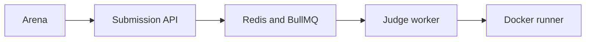

# Architecture

## Application boundaries

| Layer | Main entry points | Responsibility |
| --- | --- | --- |
| Student site | `server.mjs`, `index.html`, `assets/app.js` | Landing, Learn, browser-local features, and Passport views |
| Arena | `arena/src.jsx`, `arena/editor.jsx`, `arena/navigation.js` | Browse problems, edit drafts, run code, and observe verdicts |
| Judge API | `judge/api.mjs`, `judge/public-catalog.mjs` | Public catalog projection, signed browser identity, submission ownership, and SSE |
| Execution | `judge/worker.mjs`, `judge/container.mjs`, `judge/verdict.ts` | Queue reconciliation, isolated compilation and execution, verdicts, and contest scoring |
| Data | `db/schema.sql`, `scripts/seed.mjs`, `judge/services.mjs` | PostgreSQL, Redis, object storage, and local fixture seeding |
| External evidence | `evidence/connectors.mjs` | Platform imports and signed snapshots |

## Submission life cycle

1. The API validates code, input size, supported language, browser ownership, and submission limits. It commits the PostgreSQL row as `PENDING` before queuing its ID.
2. The worker retries transient failures. Reconciliation finds unfinished submissions with missing jobs and marks exhausted jobs unavailable. Finalization updates only unfinished rows.
3. Compilation and case execution take place in separate, network-disabled, non-root containers. Runners use a read-only root filesystem and limits on time, CPU, memory, processes, and output.
4. The worker reads grading fixtures from object storage and compares program output. The API streams owner-scoped status and final verdict over SSE. Hidden inputs and expected results stay out of the browser response.
5. Decode progress counts distinct accepted challenges and unlocks the editorial for the current browser identity. Custom runs earn no progress or contest points. Contest standings rank solved count, then penalty time. Penalty includes minutes to each first acceptance plus 20 minutes for each eligible earlier wrong answer, timeout, memory limit, or runtime error on that problem.

## Routes and contracts

| Route | Contract |
| --- | --- |
| `/`, `/learn`, `/profile` | Student site, study track, and Skill Passport |
| `/arena`, `/arena/decode`, `/arena/solve` | Default Decode entry, Decode catalog, and standalone problems |
| `/arena/problems/:slug`, `/arena/problems/:slug/editorial` | Direct problem and editorial routes. Unknown slugs receive a 404. |
| `/arena/contests`, `/arena/contests/:slug` | Contest schedule and contest details |
| `GET /api/problems`, `GET /api/problems/:slug` | Public metadata, sample cases and starter code. The offline catalog signals unavailable progress with `solved: null`. |
| `POST /api/submissions` | Accepts `slug`, `language` (`c`, `cpp`, `python`), and `code`. Include `customInput` for a run or an eligible `contest` for contest grading. Returns a submission ID with HTTP 202. |
| `GET /api/submissions/:id/events` | Owner-only stream of queued, compiling, running, and final states |
| `GET /api/submissions?problem=:slug`, `GET /api/submissions/:id/source` | Owner-only attempt list and finished graded source |
| `GET /api/evidence/arena` | Signed-session acceptance totals, daily activity, and recent accepted work |

`/decode` and `/skill-passport` redirect to the matching current routes. Catalog filters and problem links are resolved separately. Public catalog content can load without the judge stack.

## Persistence and trust

- **Browser storage** holds drafts by language, learning position, review suggestions, personal profile fields, and marketplace drafts.
- **PostgreSQL** owns problems, submissions, accepted credit, and contest standings. A signed session cookie connects one browser to its judge data.
- **Redis** transports execution jobs. PostgreSQL keeps unfinished submissions available for recovery.
- **Object storage** holds judge fixtures. Development fixtures and reference implementations live in this public repository for review and tests. A public scoring environment needs a separate private and rotated fixture bank.

See [launch gates](../LAUNCH-AUDIT.md) for durable accounts, public profiles, and execution isolation requirements.
